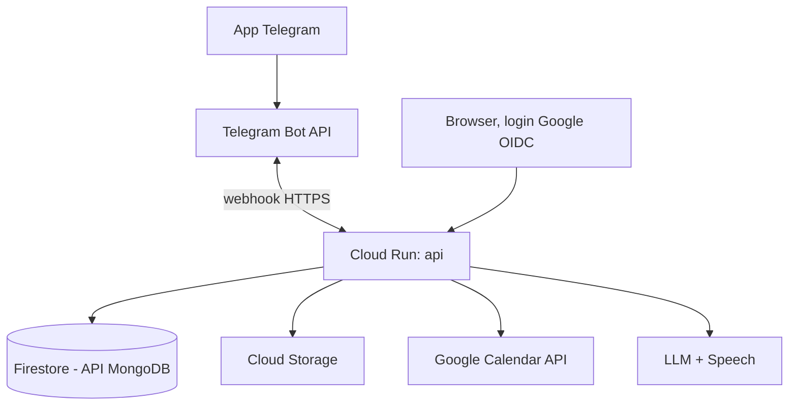
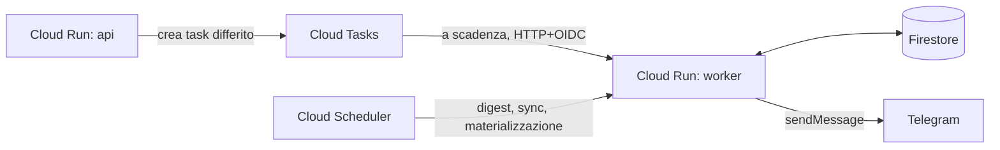

# Regole architetturali, flusso e struttura del repo

Flusso delle richieste, struttura del repository e regole architetturali del primer (§4 e §5). Le dipendenze cloud stanno dietro porte descritte in [[architettura/porte-e-fake]].

## Flusso

Percorso delle richieste (§4):



Promemoria event-driven (§4):



## Struttura del repo

Struttura prevista dal primer (§4):

```
app/
  domain/          # modelli Pydantic, enum, regole pure (ricorrenze, carico)
  schemas/         # DTO: contratto API (futura SPA)
  services/        # casi d'uso: commands/ e queries/, sempre con Actor
  repositories/    # porte (Protocol) per aggregato + adapter mongo/ e in-memory
  integrations/    # google_calendar, llm, stt, link_fetcher, telegram_client, task_queue
  interfaces/
    telegram/      # webhook handler
    agent/         # tool PydanticAI = wrapper sottili dei services
    api/           # FastAPI /api/v1 (solo GET), auth OIDC, error mapping
    internal/      # endpoint per Cloud Tasks/Scheduler (non pubblici)
    web/           # viste temporanee
  core/            # config, clock, auth, audit, logging/tracing
infra/             # Terraform (futuro)
tests/             # unit, contract (repository), integration
docker-compose.yml # MongoDB locale + fake
```

## Struttura attuale dei moduli

Al momento (M0) il codice copre solo le fondamenta; questa è la fotografia del presente, da non confondere con la struttura prevista qui sopra.

Presenti:

- `app/core/` — `config.py` (impostazioni da ambiente, cache di processo), `clock.py` (porta `Clock` e `SystemClock`), `logging.py` (log JSON su stdout).
- `app/domain/` — `actor.py` con `Actor` e `Source` (`telegram`, `web`, `agent`, `scheduler`): nessun modello di dominio vero e proprio.
- `app/integrations/` — le cinque porte cloud con i rispettivi fake in memoria: `TaskQueue`, `BlobStore`, `SecretProvider`, `LLMClient`, `STTClient`. Dettaglio in [[architettura/porte-e-fake]].
- `app/interfaces/api/` — factory FastAPI con health router (`/healthz`, `/readyz`); è l'unico ingresso HTTP. `app/main.py` espone l'ASGI `app.main:app`.
- `tests/unit/` — test di configurazione, dei fake e degli endpoint di salute; `conftest.py` fornisce `FixedClock` e un `TestClient` con settings isolate.
- `scripts/verify_gcp.sh` — verifica manuale delle risorse GCP.

Assenti rispetto al primer: `schemas/`, `services/`, `repositories/`; le interfacce `telegram/`, `agent/`, `internal/`, `web/`; gli adapter reali delle integrazioni e quelli per Google Calendar, Telegram e `link_fetcher`; `infra/`; i test contract e di integrazione.

Contorno di progetto: dipendenze gestite con `uv` (FastAPI, Pydantic e pydantic-settings, uvicorn; dev: pytest, pyright, ruff, pre-commit), `pyproject.toml` con ruff e pyright configurati, `Dockerfile` e `docker-compose.yml` con MongoDB 8.0 e il servizio api. La CI ha due job: uno esegue `ruff check`, `ruff format --check`, `pyright` e `pytest`; l'altro costruisce l'immagine Docker e valida la configurazione del compose.

## Regole non negoziabili

Dieci regole architetturali, numerate come nel sorgente (§5):

1. **Nessuna logica di business in `interfaces/`**: traducono soltanto.
2. Ogni servizio riceve un `Actor(member_id, source)` con `source ∈ {telegram, web, agent, scheduler}`.
3. I servizi restituiscono **DTO**, mai documenti grezzi del DB.
4. **Solo i repository toccano il client MongoDB.** I servizi usano le porte `Protocol`; niente query nei servizi.
5. Nei repository usa un **sottoinsieme minimo e documentato** dell'API MongoDB (CRUD, filtri semplici, indici, aggregazioni basilari). Ogni operatore o stage nuovo va verificato sulla documentazione di compatibilità di Firestore **prima** dell'uso; se non è supportato, sposta la logica in Python.
6. Il tempo passa da un `Clock` iniettato; niente `datetime.now()` fuori da `core/clock.py`.
7. Ogni scrittura produce un `audit_events` (actor, source, azione, entità, diff).
8. Gli endpoint **interni** (Cloud Tasks/Scheduler) non sono pubblici: verificano il token OIDC del service account chiamante.
9. Tutto ciò che è **idempotente per costruzione** lo resta: i worker possono essere invocati più volte (retry) senza effetti doppi.
10. Le dipendenze cloud stanno dietro porte (`TaskQueue`, `BlobStore`, `SecretProvider`, `LLMClient`, `STTClient`, `Clock`), con adapter reali e fake locali.
